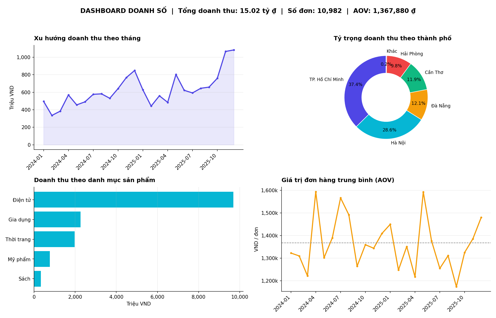

# Phân tích dữ liệu thương mại điện tử & báo cáo tự động

Luồng xử lý và trực quan hóa dữ liệu toàn trình cho bộ dữ liệu đơn hàng thương mại điện tử:
làm sạch dữ liệu → tính chỉ số kinh doanh → dashboard 2x2 → báo cáo SVG/HTML tự động.



## Công nghệ
Python · Pandas · Matplotlib · SVG/HTML · Git/GitHub

## Tính năng
- **Tiền xử lý**: loại dòng trùng, loại đơn bị hủy, chuẩn hóa tên thành phố, xử lý giá trị thiếu;
  tạo thuộc tính thời gian (Year, Month, YearMonth); tính **Tổng doanh thu** và **Giá trị đơn hàng trung bình (AOV)**.
- **Trực quan hóa**: dashboard 2x2 gồm xu hướng doanh thu theo tháng, tỷ trọng theo thành phố,
  doanh thu theo danh mục sản phẩm, AOV theo tháng.
- **Tự động hóa báo cáo**: sinh mã SVG/HTML thuần (`output/report.html`) – mở trực tiếp bằng trình duyệt, không vỡ nét ở mọi độ phân giải.
- **Quản lý phiên bản**: `.gitignore` chuẩn, commit theo từng bước.

## Cấu trúc
```
├── main.py              # chạy toàn bộ pipeline
├── src/
│   ├── generate_data.py # sinh dữ liệu mô phỏng (có nhiễu)
│   ├── analysis.py      # làm sạch + chỉ số
│   ├── dashboard.py     # dashboard Matplotlib 2x2
│   └── svg_report.py    # báo cáo SVG/HTML thuần
├── output/              # dashboard.png, report.html
└── requirements.txt
```

## Cách chạy
```bash
pip install -r requirements.txt
python main.py
```
Mở `output/report.html` bằng trình duyệt để xem báo cáo.

> Dữ liệu là dữ liệu mô phỏng. Để dùng dữ liệu thật, đặt file CSV vào `data/raw/orders.csv`
> với các cột: order_id, order_date, customer_id, city, category, quantity, unit_price, status.
